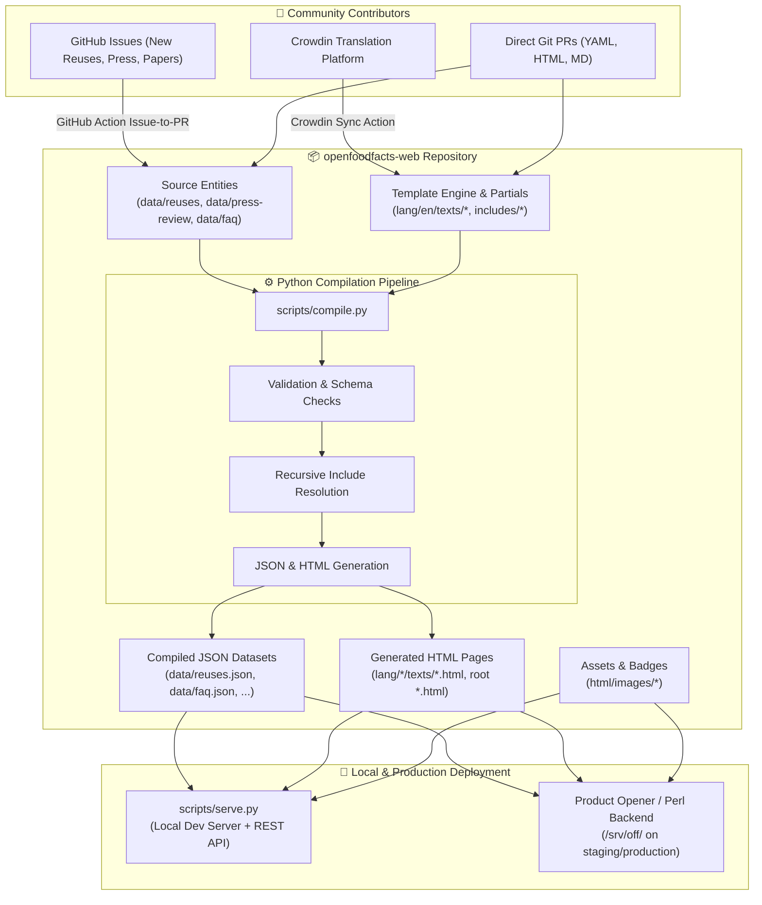
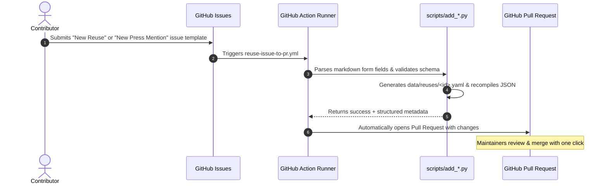

# Open Food Facts Web (`openfoodfacts-web`)
## Architecture, Feature Guide & Workflow Documentation

---

## 1. Executive Summary & Purpose

**Open Food Facts Web** (`openfoodfacts-web`) is the official content repository, static frontend engine, and curated dataset management pipeline for the [Open Food Facts](https://world.openfoodfacts.org/) ecosystem.

While the core database, search engines, and backend APIs run in **`openfoodfacts-server`** (also known as *Product Opener*), this repository hosts:
1. **100+ Static and Modular Content Pages** (Nutri-Score, Eco-Score, NOVA, mission pages, legal notices, mobile app showcases, and tutorials).
2. **Curated Open Data Entities** managed in human-readable YAML (over 600 ecosystem applications/reuses, 340+ press mentions, 138 scientific research publications, 19 scan parties, and comprehensive FAQ knowledge bases).
3. **An Automated Compilation Pipeline** (`scripts/compile.py`) that validates schemas, resolves recursive template includes (`[[texts/...]]`), compiles backward-compatible JSON datasets, and generates localized static HTML pages.
4. **GitOps Issue-to-PR Automation** enabling non-technical community contributors to submit new apps, press clippings, and research citations directly through GitHub Issue forms.
5. **Localization Infrastructure** synchronized with Crowdin across tens of languages.

---

## 2. System Architecture & Ecosystem Context



### Relationship with `openfoodfacts-server` (Product Opener)
- **Separation of Concerns:** By keeping content, editorial data, and multilingual templates in `openfoodfacts-web`, marketing, scientific, and community teams can ship content and translations without restarting or touching the core database server.
- **Template Injection:** In production, Product Opener loads static templates from `/srv/off/lang/` and injects dynamic session headers, user authentication tokens, and product bars around the content.

---

## 3. Key Features

### 3.1. Curated Entity Datasets (YAML → JSON)
Instead of monolithic, conflict-prone JSON files, data is maintained as granular YAML files:
* **Ecosystem Reuses (`data/reuses/`)**: Directory of 605+ third-party mobile apps, browser extensions, IoT scales, AI projects, and research tools utilizing Open Food Facts APIs.
* **Press Review (`data/press-review/`)**: 342+ global media mentions (Le Monde, BBC, TF1, El País, tech podcasts, TV documentaries).
* **FAQ Knowledge Base (`data/faq/<lang>/`)**: Markdown and YAML FAQ entries grouped into 26 categories across 5+ languages.
* **Scan Parties & Workshops (`data/scan_parties/`)**: Collaborative barcode-scanning events and community workshops.
* **Scientific Publications (`data/scientific_publications/`)**: 138 peer-reviewed research papers citing or analyzing Open Food Facts data.
* **Curated Queries (`data/queries/`)**: Pre-configured analytical search queries for public health and food research.

### 3.2. Interactive Frontend Applications
* **🥤 Opération Sodas (`operation-sodas.html`)**: Interactive retrospective of the very first OFF crowd-sourcing campaign in June 2012, with sugar cube visualizations and brand comparisons.
* **🏷️ Scan Parties Hub (`scan-parties.html`)**: Barcode contribution workshop organizer hub featuring an interactive shelf barcode scanner simulator.
* **🥛 What's in my Yogurt? (`whats-in-my-yogurt.html`)**: Campaign page exploring additives and sugar in yogurts and dairy products.
* **🧴 What's in my Shampoo? (`whats-in-my-shampoo.html`)**: Open Beauty Facts companion application analyzing cosmetic ingredients and allergens.
* **💼 Pro Platform (`index-pro-2.html` / `/pro`)**: Template portal for manufacturers and producers to share authoritative product specifications.
* **📱 Mobile App Features (`mobile-features.html`)**: Modern showcase of the Smooth App (offline scan, lists, dietary alerts, Eco-Score breakdown).
* **🌍 Global Impact Report (`impact.html`)**: Transparent metrics on non-profit funding, server infrastructure, and ecosystem reach.

### 3.3. Template Engine & Recursive Include Resolution
The project uses an include syntax:
```html
[[texts/pro/blocks/hero.html]]
[[texts/pro/blocks/ecosystem.html]]
```
The compilation engine and development server resolve these directives recursively, allowing modular page assembly while maintaining standalone previewability.

### 3.4. Local Development Server & REST API Hub (`scripts/serve.py`)
A zero-dependency server that provides:
* **Frontend Portal (`/`)**: Central launchpad linking to all interactive apps, showcases, and 100+ pages with real-time live search.
* **Full REST API v2 (`/api/v2/*`)**: High-performance JSON endpoints supporting search queries, category filters, and pagination.
* **Interactive API Explorer (`/api/docs`)**: In-browser testing playground to inspect JSON payloads in real time.
* **On-Demand Compilation (`POST /api/compile`)**: Instant pipeline execution from the browser or CI.

---

## 4. Operational Workflows

### Workflow 1: Community Contribution (Issue-to-PR GitOps)
To allow anyone to contribute without writing code or learning Git:


### Workflow 2: Automated Validation & Compilation (`scripts/compile.py`)
Run locally or in CI:
```powershell
# Dry-run validation (checks YAML syntax, link formats, banned acronyms)
python scripts/compile.py --check

# Full compilation (generates JSON datasets and localized HTML files)
$env:PYTHONUTF8=1; python scripts/compile.py
```
**Compilation Steps:**
1. Validates all entities against schema (banned OFF acronyms, valid categories, valid URL formats).
2. Strips internal editorial comments (`editorial_note`) before writing public JSON datasets.
3. Generates localized HTML pages and updates language directories.

### Workflow 3: Localization Pipeline (Crowdin)
1. Source strings in `lang/en/texts/` are synced to **Crowdin** via `.github/workflows/crowdin-split.yml`.
2. Translators localize text into French, Spanish, German, Italian, etc.
3. Automated PRs import translated blocks into `lang/<lang>/texts/`.

### Workflow 4: Staging & Production Deployment
* **Pre-prod (`world.openfoodfacts.net`)**: Automatically deployed on pushes to `main` via `.github/workflows/preprod-deploy.yml`. The workflow connects via SSH to the staging server, pulls latest commits, and restarts the backend container.
* **Production (`world.openfoodfacts.org`)**: `/lang` and `/html` directories are deployed to `/srv/off/` on bare-metal clusters hosted by the Free Foundation.

---

## 5. Directory Map

```
openfoodfacts-web/
├── .github/
│   ├── workflows/             # CI/CD: issue-to-pr, preprod deploy, Crowdin sync
│   └── ISSUE_TEMPLATE/        # Structured YAML contribution forms
├── data/
│   ├── faq/                   # Categorized Markdown FAQ questions by language
│   ├── missions/              # YAML data for historical campaigns (Sodas, Yogurt, Shampoo)
│   ├── press-review/          # 342+ press clipping YAML files
│   ├── queries/               # 35 curated analytical queries
│   ├── reuses/                # 605+ ecosystem application YAML files
│   ├── scan_parties/          # 19 scan party YAML files
│   ├── scientific_publications/ # 138 research paper YAML files
│   ├── faq.json               # Compiled aggregate datasets
│   ├── press-review-merged.json
│   ├── reuses.json
│   └── scientific_publications.json
├── html/
│   └── images/                # Static assets (logos, partner badges, illustrations)
├── lang/
│   ├── en/texts/              # English source HTML pages and partials
│   ├── fr/texts/              # French localized pages
│   ├── de/texts/              # German localized pages
│   ├── es/texts/              # Spanish localized pages
│   └── it/texts/              # Italian localized pages
├── scripts/
│   ├── compile.py             # Master pipeline compiler and orchestrator
│   ├── compile_reuses.py      # Reuses processor
│   ├── compile_press_review.py# Press review processor
│   ├── compile_faq.py         # FAQ compiler
│   ├── compile_scan_parties.py# Scan parties compiler
│   ├── compile_campaign_pages.py # Sodas, Yogurt, Shampoo compiler
│   ├── compile_pro_page.py    # Pro platform template resolver
│   ├── add_reuse.py           # CLI & Action helper for reuses
│   ├── add_press_review.py    # CLI & Action helper for press clippings
│   └── serve.py               # Local full-stack dev server & REST API hub
├── impact.html                # Global impact & metrics report
├── operation-sodas.html       # Opération Sodas interactive app
├── scan-parties.html          # Scan Parties simulator & hub
├── whats-in-my-yogurt.html    # Yogurt campaign page
├── whats-in-my-shampoo.html   # Shampoo campaign page
├── mobile-features.html       # Mobile app features gallery
└── PAGELIST.md                # Exhaustive inventory of all pages with live links
```

---

## 6. Developer Cheat Sheet

| Task | Command |
| :--- | :--- |
| **Start Local Dev Server** | `python scripts/serve.py --port 8080` |
| **Validate All Entities** | `python scripts/compile.py --check` |
| **Compile All Datasets & HTML** | `$env:PYTHONUTF8=1; python scripts/compile.py` |
| **Compile Only Reuses** | `python scripts/compile.py --reuses` |
| **Compile Only Press Review** | `python scripts/compile.py --press` |
| **Compile Only FAQ** | `python scripts/compile.py --faq` |
| **Compile Pro Platform Preview** | `python scripts/compile_pro_page.py` |
| **Add a Reuse via CLI** | `python scripts/add_reuse.py --name "AppName" --theme nutrition --website "https://..." --compile` |
