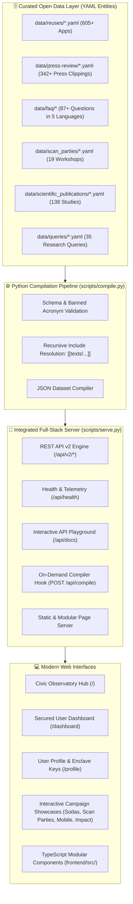

# ALIMENTA GLOBAL — Planetary Nutritional Intelligence & Open Food Commons

<div align="center">

[](https://opendatacommons.org/licenses/odbl/)
[](https://python.org)
[](https://www.typescriptlang.org/)
[](http://localhost:8080/api/docs)
[](http://localhost:8080/)
[](https://world.openfoodfacts.org/)

**A futuristic, open-access public health observatory and food transparency ecosystem built on the global Open Food Facts data commons.**

[Live Portal](http://localhost:8080/) &middot; [API Documentation](http://localhost:8080/api/docs) &middot; [Secured Dashboard](http://localhost:8080/dashboard) &middot; [Architecture Guide](PROJECT_OVERVIEW.md)

</div>

---

## 🌍 1. Executive Summary & Mission

**ALIMENTA GLOBAL** is an open-source, civic observatory and digital food intelligence ecosystem. Built upon the foundation of **Open Food Facts**—the world’s largest collaborative, open database of food products—ALIMENTA GLOBAL transforms raw global food data into an interactive, public-interest social service platform aligned with UNESCO digital public goods and global public health objectives.

The platform provides:
1. **Planetary Food Transparency**: Unrestricted access to Nutri-Score, Eco-Score, NOVA food processing classifications, ingredient toxicology, and allergen telemetry across millions of products.
2. **Curated Open Data Vault**: Structured, versioned datasets spanning 605+ third-party ecosystem applications, 342+ global media mentions, 138 peer-reviewed research papers, 35 curated health queries, and community scan workshops.
3. **High-Performance Compilation Engine**: An automated Python pipeline (`scripts/compile.py`) that performs schema validation, resolves recursive template includes (`[[texts/...]]`), strips editorial flags, and compiles production JSON artifacts.
4. **Zero-Dependency Full-Stack Hub**: A high-concurrency Python HTTP development server (`scripts/serve.py`) providing a unified REST API v2 engine alongside rich HTML5 interactive applications.
5. **Secured User Enclave**: Authenticated client dashboards and profile telemetry protected by token expiration guards, session synchronization, and cryptographic mock credentials.
6. **Modular TypeScript Architecture**: A structured frontend client layer (`frontend/src/`) featuring reactive state hooks, API clients, authentication guards, and reusable UI components.

---

## 🏗️ 2. System Architecture



---

## 🚀 3. Quick Start & Local Execution

### Prerequisites
* **Python 3.10+** (Tested on Python 3.14 on Windows, Linux, and macOS).
* **Git**
* Zero external pip dependencies required for running the integrated server! (Standard library `http.server`, `socketserver`, `json`, `urllib`).

### Step 1: Clone the Repository
```bash
git clone https://github.com/SunBreaThing441/ALIMENTA-GLOBAL-Planetary-Nutritional-Intelligence-Open-Food-Commons.git
cd ALIMENTA-GLOBAL-Planetary-Nutritional-Intelligence-Open-Food-Commons
```

### Step 2: Start the Full-Stack Server
Launch the unified server (hosts both backend REST API and frontend web pages):
```powershell
# Windows PowerShell:
$env:PYTHONUTF8=1; python scripts/serve.py --port 8080

# Linux / macOS:
PYTHONUTF8=1 python3 scripts/serve.py --port 8080
```

The server will initialize memory caches for all datasets and start on:
* **Frontend Portal**: `http://localhost:8080/`
* **API Documentation**: `http://localhost:8080/api/docs`
* **Health Check**: `http://localhost:8080/api/health`

### Step 3: Run the Data Compilation Pipeline
Validate entities and rebuild aggregate JSON datasets:
```powershell
# Dry-run validation only (verifies syntax, URL formats, and schemas)
python scripts/compile.py --check

# Full pipeline compilation (rebuilds data/*.json and static HTML)
$env:PYTHONUTF8=1; python scripts/compile.py
```

---

## ⚡ 4. REST API v2 Specification

ALIMENTA GLOBAL exposes high-performance REST API v2 endpoints for developers, public health researchers, and ecosystem builders:

| Method | Endpoint | Query Parameters | Description |
| :--- | :--- | :--- | :--- |
| `GET` | `/api/health` | None | System uptime, Python runtime, and active dataset metrics |
| `GET` | `/api/docs` | None | Interactive in-browser API explorer and query runner |
| `GET` | `/api/v2/reuses` | `search`, `limit`, `offset` | Search and paginate 605+ third-party ecosystem tools & apps |
| `GET` | `/api/v2/press` | `search`, `type`, `limit`, `offset` | Filter 342+ global media mentions (articles, podcasts, videos) |
| `GET` | `/api/v2/faq` | `lang` (`en`, `fr`, `es`, `de`, `it`) | Multi-language FAQ knowledge categories and questions |
| `GET` | `/api/v2/scan-parties` | None | Complete catalog of 19 collaborative barcode scan workshops |
| `GET` | `/api/v2/publications`| `limit` | 138 peer-reviewed research papers referencing Open Food Facts |
| `GET` | `/api/v2/queries` | `limit` | Curated statistical queries for food composition analysis |
| `GET` | `/api/v2/mobile-features`| None | Feature catalog of the official mobile applications |
| `POST`| `/api/compile` | None | Triggers pipeline recompilation and reloads memory datasets |

### Example API Request & Response
```bash
curl -s "http://localhost:8080/api/v2/reuses?limit=1&search=nutrition"
```
```json
{
  "total": 605,
  "limit": 1,
  "offset": 0,
  "results": [
    {
      "id": "buttery-recipes",
      "name": "Buttery",
      "tagline": "Recipe application powered by open food data & semantic web standards",
      "theme": "tools",
      "country_label": "Worldwide",
      "website": "https://buttery.recipes",
      "odbl_compliant": true,
      "featured": true
    }
  ]
}
```

---

## 🖥️ 5. Applications & Showcase Directory

| Interface | URL Path | Highlights |
| :--- | :--- | :--- |
| **Civic Observatory Hub** | [`/`](http://localhost:8080/) | Live search, animated telemetry counters, dataset explorer, on-demand compilation terminal |
| **Secured User Dashboard** | [`/dashboard`](http://localhost:8080/dashboard) | Session expiry countdown, audited products counter, mock key management, access logs |
| **Secured User Profile** | [`/profile`](http://localhost:8080/profile) | Node role tiers (`RESEARCHER`, `DATA_STEWARD`, `OBSERVER`), API key generation, active sessions |
| **Opération Sodas** | [`/operation-sodas.html`](http://localhost:8080/operation-sodas.html) | Retrospective of the 2012 sugar crowd-sourcing campaign with sugar cube visualizations |
| **Scan Parties Hub** | [`/scan-parties.html`](http://localhost:8080/scan-parties.html) | Interactive barcode contribution workshop simulator with real-time barcode decoding |
| **Mobile App Features** | [`/mobile-features.html`](http://localhost:8080/mobile-features.html) | Offline mode, personalized dietary alerts, lists, and Eco-Score impact breakdown |
| **Producer Platform** | [`/pro`](http://localhost:8080/pro) | Authoritative product catalog data sharing portal for manufacturers and brands |
| **Global Impact Report** | [`/impact.html`](http://localhost:8080/impact.html) | Non-profit governance, server infrastructure disclosures, and funding transparency |

---

## 📂 6. Repository Layout

```
ALIMENTA-GLOBAL/
├── data/
│   ├── faq/                      # Multilingual markdown FAQ categories (en, fr, es, de, it)
│   ├── missions/                 # Campaign metadata (Sodas, Yogurt, Shampoo)
│   ├── press-review/             # 342+ press clipping YAML files
│   ├── queries/                  # 35 curated analytical food queries
│   ├── reuses/                   # 605+ third-party ecosystem application YAML files
│   ├── scan_parties/             # 19 collaborative scan workshop YAML files
│   ├── scientific_publications/  # 138 peer-reviewed research study YAML files
│   ├── faq.json                  # Compiled aggregate JSON datasets
│   ├── press-review-merged.json
│   ├── queries.json
│   ├── reuses.json
│   ├── scan_parties.json
│   └── scientific_publications.json
├── frontend/
│   └── src/
│       ├── components/           # CivicObservatoryHub, CompositionSpectrum, ScientificVault, etc.
│       ├── context/              # AuthContext (session synchronization, token countdown)
│       ├── hooks/                # useEcosystemData (caching, retries, REST ingestion)
│       ├── pages/                # SecureDashboard, SecureProfile
│       ├── router/               # RouteGuard (client-side route protection)
│       ├── services/             # api.client.ts, auth.service.ts
│       └── types/                # Strict TypeScript entity definitions
├── html/
│   └── images/                   # Static logos, badges, and partner illustrations
├── lang/
│   ├── en/texts/                 # English modular HTML content blocks
│   ├── fr/texts/                 # French translations
│   ├── de/texts/                 # German translations
│   ├── es/texts/                 # Spanish translations
│   └── it/texts/                 # Italian translations
├── scripts/
│   ├── serve.py                  # Integrated full-stack server & REST API v2 hub
│   ├── compile.py                # Master dataset compilation & validation orchestrator
│   ├── compile_reuses.py         # Reuses dataset processor
│   ├── compile_press_review.py   # Press clippings processor
│   ├── compile_faq.py            # FAQ compiler
│   └── compile_scan_parties.py   # Scan parties compiler
├── PROJECT_OVERVIEW.md           # In-depth architectural & operational guide
├── PAGELIST.md                   # Exhaustive inventory of all 100+ pages
├── operation-sodas.html          # Opération Sodas interactive app
├── scan-parties.html             # Scan Parties barcode simulator
├── mobile-features.html          # Mobile features gallery
├── impact.html                   # Non-profit impact report
└── README.md                     # Project documentation
```

---

## 🔒 7. Security & Authentication Architecture

User-end routes (`/dashboard` and `/profile`) implement client-side navigational guards and token lifecycles:
* **Session Interception**: Navigation to protected routes requires an active cryptographic session token. Unauthenticated users are shown a security challenge card.
* **Token Expiration Telemetry**: Sessions feature a real-time countdown timer. When expired, access is revoked automatically.
* **Role-Based Access Control**: Tiered credentials for `INDEPENDENT_OBSERVER`, `CIVIC_RESEARCHER`, and `DATA_STEWARD`.
* **Cross-Tab Synchronization**: Uses `BroadcastChannel('alimenta_auth_sync')` to synchronize session logouts across all browser tabs.

---

## 🤝 8. Contributing & GitOps Automation

Contributions are welcome from developers, food scientists, dietitians, and open-data advocates!

1. **Submit a New App / Reuse**: Open an issue using the [New Reuse Template](.github/ISSUE_TEMPLATE/add-a-reuse.yml). GitHub Actions will automatically parse the YAML form and open a Pull Request.
2. **Submit a Press Clipping**: Open an issue using the [Press Clipping Template](.github/ISSUE_TEMPLATE/add-a-press-mention.yml).
3. **Translations**: Multilingual strings are synchronized with [Crowdin](https://translate.openfoodfacts.org).

---

## 📜 9. License & Credits

* **Data**: Published under the [Open Database License (ODbL) v1.0](https://opendatacommons.org/licenses/odbl/).
* **Code**: Released under the [Apache License 2.0](LICENSE).
* **Powered by**: The global community of [Open Food Facts](https://world.openfoodfacts.org/) contributors and researchers.
